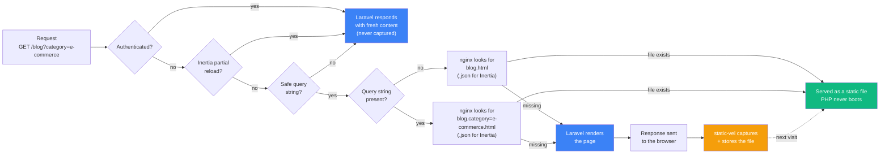

# Static response caching for Laravel

Effortless static response caching for Laravel: capture rendered responses **after** they are sent, then let nginx serve them as plain files — without touching Laravel at all.



- **Opt-in per route** — pages are only captured where you attach the `static-vel` middleware.
- **Zero request overhead** — capture happens in `terminate()`, *after* the browser already got the response.
- **Web-server serving** — nginx returns the stored file for matching paths and falls back to Laravel when no file exists.
- **Inertia-aware** — with `handle_inertia` enabled, Inertia JSON payloads are captured too, so client-side navigations are served statically as well.

## Requirements

- PHP 8.3+
- Laravel 11, 12 or 13
- nginx (or any web server able to serve files with a fallback to Laravel)

## Installation

```bash
composer require mehedimi/static-vel
```

Optionally publish the config file:

```bash
php artisan vendor:publish --tag=static-vel-config
```

## Capturing pages

Attach the `static-vel` middleware alias to any route or route group whose rendered response is identical for every visitor:

```php
use Illuminate\Support\Facades\Route;

Route::middleware('static-vel')->group(function () {
    Route::view('/', 'welcome');
    Route::view('/about', 'about');
    Route::get('/products/{product}', [ProductController::class, 'show']);
});
```

The first `GET` request that returns a `200` response is written to `storage/static-vel/` **after** the response has been sent. `/` is treated as `index`, and the response kind decides the extension:

| Request                          | Stored file                              |
| -------------------------------- | ---------------------------------------- |
| `/` (page load)                  | `storage/static-vel/index.html`          |
| `/` (Inertia visit)              | `storage/static-vel/index.json`          |
| `/about` (page load)             | `storage/static-vel/about.html`          |
| `/about` (Inertia visit)         | `storage/static-vel/about.json`          |
| `/blog?category=e-commerce`      | `storage/static-vel/blog.category=e-commerce.html` |
| `/products/12`                   | `storage/static-vel/products/12.html`    |

Files are written atomically (temporary file + `rename`), so nginx never picks up a half-written page.

### What is *not* captured

- Non-`GET` requests
- Responses with a status code other than `200` (redirects, 404s, 500s…)
- Streams and file downloads
- Responses that are neither `text/html` nor an Inertia `application/json` payload
- Inertia **partial reloads** (`X-Inertia-Partial-Component`) — they exist to fetch fresh data, and caching them would overwrite the full payload with a subset of props
- Inertia visits, when `handle_inertia` is `false`
- Requests carrying the [auth marker cookie](#authenticated-visitors) — authenticated visitors' responses must never overwrite the guest cache
- Requests with an [unsafe query string](#query-strings) (too long, or containing characters that could form a path)
- Paths attempting traversal (`/..%2Fetc/passwd`)

### Query strings

The raw query string becomes part of the file name, so every variant is cached on its own:

- `/blog` → `blog.html`
- `/blog?category=e-commerce` → `blog.category=e-commerce.html`
- `/blog?page=2` → `blog.page=2.html`

The rules:

- The query string is used **verbatim** (raw, exactly as sent). `?category=e%2Dcommerce` and `?category=e-commerce` are two different cache files, and so are `?a=1&b=2` and `?b=2&a=1`. Verbatim is what lets nginx reconstruct the file name from `$args` without any hashing.
- Query strings longer than 128 characters, or containing anything outside `A-Za-z0-9_=&%.+,~-` (after decoding: no slashes or backslashes) are **never cached** — those requests always reach Laravel. This keeps path traversal (`?x=..%2F..%2Fetc`) out of the file name, on both the capture and the nginx side.
- First capture wins per exact URL — a captured variant keeps serving until the cache is cleared.

> [!WARNING]
> A page whose content varies by query parameter can now be cached safely — each variant gets its own file. But every variant must still render the **same response for every visitor**: never attach the middleware to pages where a query parameter personalizes content (e.g. `?user_id=`), and never to authenticated dashboards.

## Serving with nginx

This is the whole trick: when a captured file exists, nginx serves it and Laravel is never invoked. When it doesn't, the request falls through to Laravel as usual — which is also how the page gets captured in the first place.

```nginx
server {
    listen 80;
    server_name example.com;

    root /var/www/example.com/public;
    index index.php;

    # Internal redirect targets:
    #   418 -> requests with a query string, served from their own file
    #   419 -> "hand this to Laravel"
    # Both codes are deliberately obscure, so they never collide with a
    # real response.
    error_page 418 = @static_query;
    error_page 419 = @laravel;

    # 1. Rewrite every page request to its static file:
    #    /about      -> /static-vel/about.html
    #    /           -> /static-vel/index.html
    #    /blog?x=y   -> /static-vel/blog.x=y.html   (via @static_query)
    #    Inertia nav -> the same file with the .json extension
    location / {
        # Logged-in visitors always get fresh content from Laravel.
        if ($cookie_static_vel_auth) {
            return 419;
        }

        # Partial reloads ask for fresh data - always let Laravel answer.
        if ($http_x_inertia_partial_component) {
            return 419;
        }

        # Query strings that must never become part of a file name
        # (raw or encoded slashes, backslashes, dot segments) - let
        # Laravel answer. This allowlist is mirrored by the middleware.
        if ($args ~ "[^A-Za-z0-9_=&%.+,~-]") {
            return 419;
        }
        if ($args ~ "(%2F|%2f|%5C|%5c)") {
            return 419;
        }

        # Defense in depth: $args is the one input nginx does NOT
        # normalize, so dot segments are rejected outright.
        if ($args ~ "\.\.") {
            return 419;
        }

        # Requests with a query string are served from their own file.
        if ($args) {
            return 418;
        }

        set $ext html;
        if ($http_x_inertia) {
            set $ext json;
        }

        rewrite ^/$ /static-vel/index.$ext last;
        rewrite ^ /static-vel$uri.$ext last;
    }

    # 2. Same as above, but the file name carries the query string.
    location @static_query {
        set $ext html;
        if ($http_x_inertia) {
            set $ext json;
        }

        rewrite ^/$ /static-vel/index.$args.$ext last;
        rewrite ^ /static-vel$uri.$args.$ext last;
    }

    # 3. Serve the rewritten path from the storage directory.
    #    `internal` keeps the cache from being requested directly.
    location ^~ /static-vel/ {
        internal;

        # Defense in depth: $uri is already normalized by nginx (dot
        # segments are resolved before location matching), and the
        # middleware never stores such file names. This guard only
        # protects against future config edits.
        if ($uri ~ "\.\.") {
            return 404;
        }

        # Parent directory of the storage path (storage/static-vel by default).
        # Point this at your `public` directory if you store inside public/.
        root /var/www/example.com/storage;

        try_files $uri @laravel;
    }

    # 4. Fallback: let Laravel render (and capture) the page.
    location @laravel {
        rewrite ^ /index.php last;
    }

    location ~ \.php$ {
        include snippets/fastcgi-php.conf;
        fastcgi_pass unix:/var/run/php/php8.3-fpm.sock;
    }
}
```

A request for `/about` therefore resolves as:

1. A browser page load → nginx looks for `storage/static-vel/about.html` → served, PHP never boots.
2. An Inertia navigation (`X-Inertia` header) → nginx looks for `storage/static-vel/about.json` → served, PHP never boots.
3. A request with a query string (`/blog?category=e-commerce`) → nginx looks for `storage/static-vel/blog.category=e-commerce.html` → served, PHP never boots.
4. No file yet (or an unsafe query string, or a logged-in visitor) → `@laravel` → Laravel renders the page → the middleware stores it after the response is sent.
5. Every future visitor gets the static file until the cache is cleared.

Notes:

- The same config works whether `handle_inertia` is `true` or `false` — with `false` no `.json` files are ever stored, so Inertia requests simply miss the cache and reach Laravel.
- The query-string allowlist in nginx must match the one in the middleware (`A-Za-z0-9_=&%.+,~-`, plus rejecting encoded slashes) — they are the two halves of the same file-name convention.
- Don't register application routes under the `/static-vel/` prefix — it belongs to the cache.

> [!NOTE]
> **Why the rewrites can't be tricked into directory traversal (`../`):**
>
> - `$uri` is **normalized by nginx before location matching** — `%XX` sequences are decoded, `.` and `..` segments are resolved, and slashes are merged. A request for `/blog/..%2f..%2fstorage` never reaches the rewrites as dots; `$uri` becomes `/storage`. So the rewritten path `/static-vel$uri.$ext` can only point *deeper*, never *up*.
> - `$args` is the one input nginx does **not** normalize — which is exactly why it is vetted on both sides: a character allowlist, encoded-slash rejection (`%2F`, `%5C`), and an explicit `..` rejection. If anything looks off, the request goes to Laravel instead of a file lookup.
> - The file-serving `location ^~ /static-vel/` is `internal` — an attacker can never request those URLs directly.
> - The `if ($uri ~ "\.\.")` guard inside the cache location is pure defense in depth for future config edits.

## Serving with Laravel Octane / PHP-PM

Application servers (Laravel Octane with Swoole, RoadRunner or FrankenPHP, and PHP-PM) don't use PHP-FPM — the app listens on a TCP port and nginx proxies to it. Keep everything above the same, but replace the fallback and the PHP location:

```nginx
    # Fallback: hand the ORIGINAL request URI to the application server.
    # $request_uri is untouched by the rewrites above, so Laravel sees
    # exactly what the client asked for.
    location @laravel {
        proxy_pass http://127.0.0.1:8000$request_uri;

        proxy_set_header Host $host;
        proxy_set_header X-Real-IP $remote_addr;
        proxy_set_header X-Forwarded-For $proxy_add_x_forwarded_for;
        proxy_set_header X-Forwarded-Proto $scheme;
    }

    # The fastcgi location is not needed with an application server.
```

> [!IMPORTANT]
> `proxy_pass http://127.0.0.1:8000$request_uri;` — the `$request_uri` part matters. Without it, nginx forwards the *rewritten* URI (`/static-vel/blog.x=y.html`), and Laravel would 404 on every cache miss.

Notes for long-running workers:

- **Octane** invokes terminable middleware after flushing the response, so capture works out of the box; the middleware itself is stateless and safe for persistent workers.
- **PHP-PM** uses the same proxy fallback (adjust the port). Its handling of terminable middleware has historically been inconsistent across versions — after installing, verify that the first visit actually creates a file under the storage path; if it doesn't, the static layer still serves whatever was captured by other means.
- `php artisan static-vel:clear` stays in the deploy script exactly the same.

## Authenticated visitors

nginx cannot check Laravel sessions — but it can inspect cookies. static-vel maintains a dedicated **marker cookie** (`static_vel_auth`, configurable) that only exists for authenticated visitors:

- The package sets the cookie automatically on the `Login` event and clears it on `Logout` — no setup required.
- The nginx config above skips the static cache whenever the request carries the cookie (`if ($cookie_static_vel_auth)`) and lets Laravel render the page.
- The capture middleware also skips requests carrying the cookie (and authenticated users in general), so personalized responses can never overwrite the guest cache.

Result: **guests get the static page, logged-in users always get fresh content from the application.**

### Keeping the cookie in sync (recommended)

Add the sync middleware to your `web` middleware group so the cookie always mirrors the real auth state — it covers sessions that predate the package install, remember-me auto-logins, and session expiry without a logout event:

```php
// bootstrap/app.php
->withMiddleware(function (Middleware $middleware) {
    $middleware->web(append: [
        \Mehedi\StaticVel\Http\Middleware\SyncAuthCookie::class,
    ]);
})
```

Notes:

- The very first request after a login (or remember-me auto-login) may still receive the cached guest page — the marker cookie is only sent back with the *next* request. After that, the user is on Laravel-rendered pages.
- Drift is always fail-safe: a stale marker cookie only costs a cache miss (Laravel renders), never wrong content.
- Auth detection is cookie-based. Visitors authenticated purely by API tokens (Authorization headers) are treated as guests by nginx.
- Avoid dashes in the cookie name — nginx exposes cookies as `$cookie_<name>` variables.

## Inertia support

Set `handle_inertia` to `true` (the default) and static-vel handles the full picture:

- **Full page loads** (no `X-Inertia` header) are served the HTML shell.
- **Inertia navigations** (client-side link clicks, `X-Inertia: true`) are served the cached JSON payload — component, props, url and version included.
- **Partial reloads** (`X-Inertia-Partial-Component`) always reach Laravel: they exist precisely to fetch *fresh* props, and the middleware never caches their subset payloads.

> [!IMPORTANT]
> **Always clear the static cache after deploying.** The Inertia version and the hashed asset URLs (`/assets/app-abc123.js`) are baked into the captured HTML *and* JSON. A stale static file would reference deleted assets. Add this to your deploy script:

```bash
php artisan static-vel:clear
```

## Cache invalidation

```bash
php artisan static-vel:clear
```

Removes every captured page (the directory itself is kept). Run it after each deploy, or whenever a page's content changes.

Since nginx serves files directly, there is no TTL — a captured page stays until you clear it. Build the clear step into your deploy pipeline (e.g. as a [Laravel Deployer](https://deployer.org/) or Forge deploy script task).

## Configuration

Published as `config/static-vel.php`:

| Key | Default | Description |
| --- | --- | --- |
| `enabled` | `env('STATIC_VEL_ENABLED', true)` | Master switch. The middleware becomes a pass-through when `false`. |
| `path` | `env('STATIC_VEL_PATH', storage_path('static-vel'))` | Directory captured responses are written to. |
| `handle_inertia` | `env('STATIC_VEL_HANDLE_INERTIA', true)` | Also capture Inertia JSON payloads as `<path>.json`. |
| `auth_cookie` | `env('STATIC_VEL_AUTH_COOKIE', 'static_vel_auth')` | Marker cookie for authenticated visitors. Set to `null` to disable the auth handling. |

## Security notes

- Captured responses are served to **everyone** except authenticated visitors (detected via the auth marker cookie) — only opt in pages that are safe to share between guests.
- Never attach the middleware to authenticated dashboards: the [auth handling](#authenticated-visitors) protects guests from personalization, but a page only ever rendered for logged-in users shouldn't be captured at all.
- Path traversal (`/..%2F...`) is rejected; files can never be written outside the configured directory.
- The nginx `internal` directive on the cache location keeps captured files from being requested as URLs directly.
- First capture wins per exact URL (path + query string) — see the warning above.

## Testing

```bash
composer test
composer lint   # Pint code style
```

## Roadmap

- [ ] `static-vel:warm` — pre-generate pages from a route list (useful right after a deploy + clear)
- [ ] Apache `mod_rewrite` serving example
- [ ] Auto-invalidation on model / cache events

## License

static-vel is open-sourced software licensed under the [MIT license](LICENSE).

---

Banner powered by [ogdynamic.com](https://ogdynamic.com)
